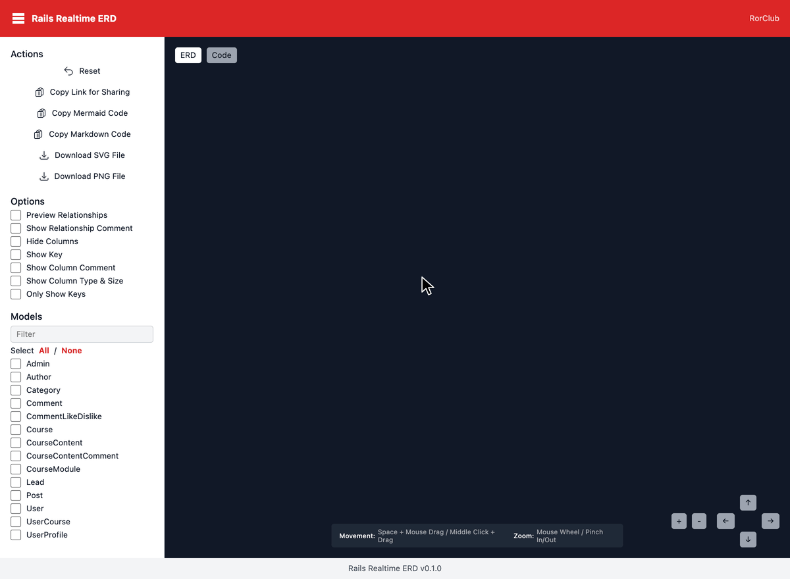

# Rails Realtime ERD

Live Mermaid ERD viewer for any Rails app, mounted as a real-time route, powered by Hotwire.

Inspired by [`rails-mermaid_erd`](https://github.com/koedame/rails-mermaid_erd) — but instead of generating a static HTML file you check into your repo, this gem mounts `GET /rails/erd` in your Rails app and renders the ERD **on every request** by introspecting your current `ActiveRecord` models and live schema. Run a migration, refresh the page, see the new diagram.

The frontend is plain Hotwire (Stimulus) — **no Vue**, no build step, no asset pipeline required in the host app.



---

## Features

- Mounts `/rails/erd` automatically in `development` and `test` environments
- On-the-fly introspection: no pre-generated HTML to keep in sync with `schema.rb`
- Mermaid ERD rendered client-side, with filters / options / zoom / pan
- Copy Mermaid code, Copy Markdown, Copy shareable URL (state in `location.hash`)
- Download SVG / PNG of the rendered diagram
- Sidebar filter to scope the diagram to a subset of models
- Optional raw column types & sizes as reported by the database (`varchar(255)`, `numeric(10,2)`, …)
- Full-window viewer: the sidebar scrolls on its own and the diagram is fitted to the pane on render
- Works with any host asset pipeline (Sprockets, Propshaft, importmap, or none) — all CSS/JS is inlined by the engine layout

## Installation

Add to your `Gemfile`:

```ruby
gem "rails-realtime-erd", group: :development
```

Then:

```bash
$ bundle install
```

That's it. Boot your Rails dev server and visit:

```
http://localhost:3000/rails/erd
```

## Compatibility

Supported versions:

| Rails | Ruby |
|---|---|
| 8.1 | 3.2 – 4.0 |
| 8.0 | 3.2 – 4.0 |
| 7.2 | 3.3 – 4.0 |
| 7.1 | 3.2 – 4.0 |
| 7.0 | 3.1 – 3.4 |
| 6.1 | 3.0 – 3.3 (Rails 6.1 itself does not load on Ruby ≥ 3.4) |

CI runs the full test suite on the oldest and newest Ruby in each range. Rails versions older than 6.1 are not supported.

## Configuration

Optional. Create `config/initializers/rails_realtime_erd.rb`:

```ruby
RailsRealtimeErd.configure do |c|
  c.mount_path           = "/rails/erd"           # default
  c.auto_mount           = true                    # default
  c.enabled_environments = %w[development test]    # default
end
```

If you set `auto_mount = false`, mount the engine yourself in `config/routes.rb`:

```ruby
mount RailsRealtimeErd::Engine => "/rails/erd"
```

## Why use it instead of `rails-mermaid_erd`?

- No rake step. No `mermaid_erd/index.html` to regenerate, share, or `.gitignore`.
- The diagram is always in sync with your live schema and models.
- No JS framework dependency in your host app — only standard Hotwire.

If you want a shareable static file (for documentation, CI artifacts, public demos), use [`rails-mermaid_erd`](https://github.com/koedame/rails-mermaid_erd). The two gems target different use cases.

## Development

Specs run against a SQLite-backed dummy Rails app in `spec/dummy`. SQLite does not preserve column/table comments, so the Builder spec asserts `nil`/`""` for those fields even though the schema declares comments — the Builder forwards whatever the connection returns, so on Postgres/MySQL those values round-trip correctly.

```bash
$ bundle install
$ bundle exec rspec
$ bundle exec standardrb
```

The root `Gemfile` targets the latest Rails. Older supported Rails versions have their own Gemfile under `gemfiles/`:

```bash
$ BUNDLE_GEMFILE=gemfiles/rails_6_1.gemfile bundle install
$ BUNDLE_GEMFILE=gemfiles/rails_6_1.gemfile bundle exec rspec
```

The Gemfiles are `gemfiles/rails_6_1.gemfile`, `rails_7_0`, `rails_7_1`, `rails_7_2`, `rails_8_0`, and the root `Gemfile` for Rails 8.1. CI (`.github/workflows/ci.yml`) runs every one of them against the Ruby versions listed under [Compatibility](#compatibility).

## License

MIT. See `MIT-LICENSE`.
